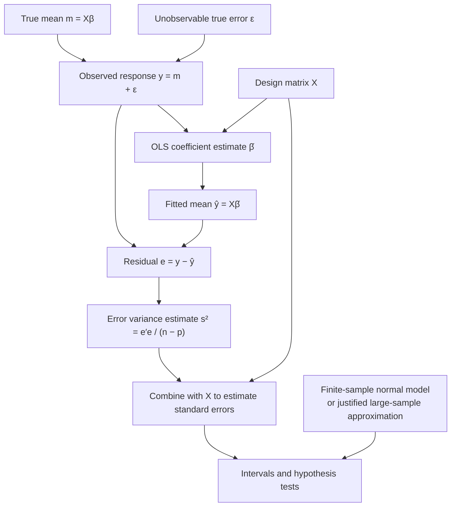

# OLS: Expectation, Variance, Residuals, and Prediction

## Purpose and review status

- Category: Statistics
- Tags: OLS, Expectation, Bias, Variance, Residuals, Degrees of Freedom, Prediction, LLN, CLT
- Date Added: 2026-10-23
- Source: [2026-10-11 Q7](../../DailyTests/2026-10-11.md#q7--confidence-vs-prediction-intervals) and the subsequent regression review discussion.
- Status: Review reference containing the discussed flowchart and derivations; this card does not change the original assessment record.

**Reading order: start with the flowchart, then Sections 1–6. Section 7 provides an optional random-design extension.** Section 8 distinguishes the roles of normality, the law of large numbers (LLN), and the central limit theorem (CLT).

## 1. Repeated sampling: what is the expectation taken over?

First hold the design matrix $`X`$ fixed. The true coefficient vector $`\beta`$ and error variance $`\sigma^2`$ are fixed but unknown. Each new error vector $`\varepsilon`$ produces a new response vector $`y`$, and therefore new coefficient estimates, fitted values, residuals, and a new variance estimate.

Expectations and variances describe the **repeated-sampling distributions** of these quantities. A fitted coefficient vector is one realization. Taking a sample variance across its different coefficients does not estimate the sampling variance of an individual coefficient estimator.

Write the model separately from its statistical assumptions:

```math
y=X\beta+\varepsilon,\qquad
X\in\mathbb R^{n\times p},\qquad
\mathrm{rank}(X)=p,\qquad n\gt p.
```

Throughout this card, $`X`$ includes an intercept, so $`p`$ counts it. Assume $`\sigma^2\gt0`$ when using standardized statistics or intervals. The following labels separate the assumptions from the matrix $`A`$ defined below:

| Assumption | Statement | Main role |
| --- | --- | --- |
| Rank | Linear representation and full column rank | Defines OLS, projections, and residuals |
| Mean | $`E(\varepsilon\mid X)=0`$ | Gives conditional unbiasedness |
| Cov | $`\mathrm{Cov}(\varepsilon\mid X)=\sigma^2I_n`$ | Homoskedastic, uncorrelated errors; gives the classical covariance formulas |

The Cov assumption does not require independence. Conditional normality is an additional distributional assumption used later for exact finite-sample inference.



The steps connect data generation, mean estimation, residual variation, sampling uncertainty, and the distribution used for inference. The flowchart does not establish the Mean or Cov assumptions; those are restrictions on the data-generating model.

## 2. The key algebra: why is the estimation error Aε?

### Step 1: define the linear map from responses to coefficients

```math
A=(X^\top X)^{-1}X^\top\in\mathbb R^{p\times n},
\qquad \hat\beta=Ay.
```

### Step 2: use full column rank

```math
AX=(X^\top X)^{-1}(X^\top X)=I_p.
```

### Step 3: substitute the model, one step at a time

```math
\begin{aligned}
\hat\beta
&=Ay\\
&=A(X\beta+\varepsilon)\\
&=(AX)\beta+A\varepsilon\\
&=\beta+A\varepsilon.
\end{aligned}
```

Therefore:

```math
\boxed{\hat\beta-\beta=A\varepsilon.}
```

**This is an algebraic identity under Rank alone. It requires neither mean-zero errors, homoskedasticity, nor normality.** Adding Mean gives:

```math
E(\hat\beta-\beta\mid X)=A\,E(\varepsilon\mid X)=0.
```

The true error uses the unknown parameters; the fitted residual is computed from the sample:

```math
\underbrace{\varepsilon=y-X\beta}_{\text{true error}},
\qquad
\underbrace{e=y-X\hat\beta}_{\text{fitted residual}}.
```

The OLS normal equations give $`X^\top e=0`$, so $`Ae=0`$. Replacing the true error by the residual in the estimation-error identity would incorrectly imply that every fitted coefficient vector equals the truth.

Also distinguish **estimation error**, $`\hat\beta-\beta`$ in one realization, from statistical **bias**, its expectation.

## 3. Projection matrices unify expectations, covariances, and residuals

Define the hat matrix and residual-maker matrix:

```math
H=XA=X(X^\top X)^{-1}X^\top,\qquad M=I_n-H.
```

Both matrices are symmetric and idempotent:

```math
H^\top=H,\quad H^2=H,\quad
M^\top=M,\quad M^2=M,\quad HM=0.
```

Since $`HX=X`$ and $`MX=0`$, the three useful representations are:

```math
\hat\beta-\beta=A\varepsilon,\qquad
\hat y-X\beta=H\varepsilon,\qquad
e=M\varepsilon.
```

Conditional on $`X`$, the matrices $`A,H,M`$ are fixed. For any fixed matrix $`B_0`$, use:

```math
E(B_0\varepsilon\mid X)=B_0E(\varepsilon\mid X),\qquad
\mathrm{Cov}(B_0\varepsilon\mid X)
=B_0\mathrm{Cov}(\varepsilon\mid X)B_0^\top.
```

This gives the following table. **The expectation column uses Rank + Mean; the covariance column uses Rank + Cov.**

| Random quantity | Conditional expectation | Conditional covariance |
| --- | --- | --- |
| $`y`$ | $`X\beta`$ | $`\sigma^2I_n`$ |
| $`\hat\beta`$ | $`\beta`$ | $`\sigma^2(X^\top X)^{-1}`$ |
| $`\hat y`$ | $`X\beta`$ | $`\sigma^2H`$ |
| $`e`$ | $`0`$ | $`\sigma^2(I_n-H)`$ |

For example, simplify the coefficient covariance as follows:

```math
\begin{aligned}
\mathrm{Cov}(\hat\beta\mid X)
&=\sigma^2AA^\top\\
&=\sigma^2(X^\top X)^{-1}X^\top X(X^\top X)^{-1}\\
&=\sigma^2(X^\top X)^{-1}.
\end{aligned}
```

### Individual training points and correlated residuals

Let $`h_{ii}=H_{ii}`$. Then:

```math
\mathrm{Var}(\hat y_i\mid X)=\sigma^2h_{ii},\qquad
\mathrm{Var}(e_i\mid X)=\sigma^2(1-h_{ii}).
```

For $`i\ne j`$, $`\mathrm{Cov}(e_i,e_j\mid X)=-\sigma^2h_{ij}`$. Residuals are generally correlated even when the original errors are uncorrelated, because they share the same estimated coefficients.

Under Rank + Cov, we also have:

```math
\mathrm{Cov}(\hat y,e\mid X)
=\sigma^2HM^\top=0.
```

Zero covariance alone does not imply independence. With an additional conditional joint-normality assumption, it does imply that $`\hat y`$ and $`e`$ are conditionally independent.

**Fitted values estimate the conditional mean $`X\beta`$ without bias under Rank + Mean.** They do not recover the realized noise in an individual observation. With an intercept, $`\mathbf1^\top e=0`$ holds algebraically in every sample; a zero sample residual mean does not verify the population restriction $`E(\varepsilon\mid X)=0`$.

### Bias, variance, and MSE have different reference points

For an estimator of a fixed scalar target $`\theta`$ with the required moments:

```math
\mathrm{Bias}(\hat\theta\mid X)=E(\hat\theta\mid X)-\theta,
```

```math
\mathrm{Var}(\hat\theta\mid X)
=E\!\left[(\hat\theta-E(\hat\theta\mid X))^2\mid X\right],
```

```math
\mathrm{MSE}(\hat\theta\mid X)
=E[(\hat\theta-\theta)^2\mid X]
=\mathrm{Var}(\hat\theta\mid X)+\mathrm{Bias}(\hat\theta\mid X)^2.
```

Unbiasedness locates the center of the repeated-sampling distribution at the target. It does not guarantee a small error in one sample. Correlated regressors can raise variance without creating bias; see [S001](../../Questions/Statistics/S001_OLS_Bias_vs_Variance_with_Correlated_Regressors.md).

## 4. Estimating error variance: why divide by n−p?

Let $`\mathrm{RSS}=e^\top e`$. Since $`e=M\varepsilon`$ and $`M^\top M=M`$:

```math
e^\top e=\varepsilon^\top M\varepsilon.
```

Under Rank + Mean + Cov, take the expectation of this quadratic form:

```math
\begin{aligned}
E(e^\top e\mid X)
&=\mathrm{tr}\!\left(ME(\varepsilon\varepsilon^\top\mid X)\right)\\
&=\sigma^2\mathrm{tr}(M)\\
&=\sigma^2\bigl(n-\mathrm{tr}(H)\bigr)\\
&=(n-p)\sigma^2.
\end{aligned}
```

Here $`\mathrm{tr}(H)=\mathrm{rank}(H)=p`$. The residual vector satisfies $`p`$ linearly independent restrictions, $`X^\top e=0`$, so the residual space has dimension $`n-p`$. Hence:

```math
\boxed{s^2=\frac{e^\top e}{n-p},\qquad E(s^2\mid X)=\sigma^2.}
```

**Normality is not needed for this unbiasedness result.** Dividing RSS by $`n`$ instead gives expectation $`(n-p)\sigma^2/n`$. Treating the residuals as an ordinary iid sample and dividing by $`n-1`$ is also biased for $`\sigma^2`$ when $`p\gt1`$.

Replace the unknown $`\sigma^2`$ with $`s^2`$ to estimate coefficient uncertainty:

```math
\widehat{\mathrm{Cov}}(\hat\beta\mid X)
=s^2(X^\top X)^{-1},\qquad
\widehat{\mathrm{SE}}_j
=s\sqrt{[(X^\top X)^{-1}]_{jj}}.
```

| Quantity | Object here | Units and meaning |
| --- | --- | --- |
| Error variance | $`\sigma^2`$, estimated by $`s^2`$ | Squared response units; size of the data noise |
| Error standard deviation | $`\sigma`$, commonly estimated by $`s`$ | Response units; $`s`$ itself is generally not unbiased for $`\sigma`$ |
| Coefficient standard error | $`\sqrt{\mathrm{Var}(\hat\beta_j\mid X)}`$, estimated above | Coefficient units; repeated-sampling variability of the estimator |

## 5. Feature sample variance uses n−1; regression error variance uses n−p

### The two variance estimates target different objects

Let each observation have $`d=p-1`$ non-intercept features, written as a column vector $`x_i`$. Their population covariance is $`\Sigma_x=\mathrm{Cov}(x_i)`$, and their sample covariance is:

```math
S_x=\frac1{n-1}\sum_{i=1}^n(x_i-\bar x)(x_i-\bar x)^\top.
```

For iid features with finite second moments, $`E(S_x)=\Sigma_x`$. This describes **how inputs vary**. In contrast, $`s^2`$ estimates $`\sigma^2`$, the **remaining response variance conditional on the inputs**.

Let $`X_c`$ contain the column-centered non-intercept features. By definition:

```math
X_c^\top X_c=(n-1)S_x.
```

In a full-rank regression with an intercept, the Cov assumption gives the following exact conditional covariance for the slope vector $`\hat b`$:

```math
\mathrm{Cov}(\hat b\mid X)
=\sigma^2(X_c^\top X_c)^{-1}
=\frac{\sigma^2}{n-1}S_x^{-1}.
```

This rewrites the same cross-product matrix in terms of the sample covariance. It does not replace every occurrence of $`n`$ by $`n-1`$. The conditional identity does not require normally distributed features.

In simple regression with an intercept:

```math
\mathrm{Var}(\hat b\mid X)
=\frac{\sigma^2}{\sum_i(x_i-\bar x)^2}
=\frac{\sigma^2}{(n-1)s_x^2}.
```

To estimate this variance, replace its numerator with $`s^2=\mathrm{RSS}/(n-2)`$, because the regression estimates an intercept and one slope. Greater input dispersion provides more information along the relevant directions; greater output noise lowers precision. In multiple regression, correlations between features also matter, so their marginal variances alone are insufficient.

### Why does ordinary sample variance divide by n−1?

Let scalar $`X_1,\ldots,X_n`$ be iid with $`E(X_i)=\mu`$ and $`\mathrm{Var}(X_i)=\sigma_x^2\lt\infty`$. Start from the identity:

```math
\sum_{i=1}^n(X_i-\bar X)^2
=\sum_{i=1}^n(X_i-\mu)^2-n(\bar X-\mu)^2.
```

Take expectations term by term:

```math
\begin{aligned}
E\!\left[\sum_i(X_i-\bar X)^2\right]
&=n\sigma_x^2-n\,\mathrm{Var}(\bar X)\\
&=n\sigma_x^2-n\frac{\sigma_x^2}{n}\\
&=(n-1)\sigma_x^2.
\end{aligned}
```

Dividing by $`n-1`$ therefore gives an unbiased estimator. If the population mean $`\mu`$ is known, $`\sum_i(X_i-\mu)^2/n`$ is already unbiased. Neither result requires normality.

### Matrix centering connects the two degrees-of-freedom calculations

Write $`v=(X_1,\ldots,X_n)^\top`$ and define the centering matrix:

```math
C=I_n-\frac{\mathbf1\mathbf1^\top}{n},\qquad
C\mathbf1=0,\qquad \mathrm{tr}(C)=n-1.
```

Then:

```math
\sum_i(X_i-\bar X)^2=v^\top Cv,
\qquad
E(v^\top Cv)=\sigma_x^2\mathrm{tr}(C)=(n-1)\sigma_x^2.
```

Sample centering removes the constant direction. General OLS residualization removes the entire $`p`$-dimensional column space of $`X`$. The corresponding degrees of freedom are $`n-1`$ and $`n-p`$.

## 6. Estimating a mean versus predicting a new observation

Fix a new input vector $`x_0\in\mathbb R^p`$ that includes an intercept. Define:

```math
m_0=x_0^\top\beta,\qquad
\hat m_0=x_0^\top\hat\beta,\qquad
h_0=x_0^\top(X^\top X)^{-1}x_0.
```

The quantity $`h_0`$ measures the mean-estimation variance at the new input relative to the training design; it need not be less than 1. Under Rank + Mean + Cov:

```math
E(\hat m_0\mid X)=m_0,\qquad
\mathrm{Var}(\hat m_0\mid X)=\sigma^2h_0.
```

This describes **uncertainty in estimating the true mean**. An independent new observation has an additional error:

```math
y_0=m_0+\varepsilon_0,\qquad
E(\varepsilon_0\mid X)=0,\qquad
\mathrm{Var}(\varepsilon_0\mid X)=\sigma^2,
```

Assume that, conditional on $`X`$, the new error is independent of the training errors. The prediction error decomposes as:

```math
y_0-\hat m_0=\varepsilon_0-x_0^\top(\hat\beta-\beta).
```

The two terms have zero conditional covariance, so:

```math
\boxed{\mathrm{Var}(y_0-\hat m_0\mid X)
=\sigma^2+\sigma^2h_0=\sigma^2(1+h_0).}
```

| Question | Target or error | Relevant variance |
| --- | --- | --- |
| What is the mean response at this input? | $`m_0`$ | $`\mathrm{Var}(\hat m_0\mid X)=\sigma^2h_0`$ |
| How variable is a new response itself? | $`y_0`$ | $`\mathrm{Var}(y_0\mid X)=\sigma^2`$ |
| How far can the prediction miss the new response? | $`y_0-\hat m_0`$ | $`\sigma^2(1+h_0)`$ |

The variance of a new response, the variance of an estimated mean, and the variance of a prediction error answer different questions.

### Exact intervals under normality

If additionally $`\varepsilon\mid X\sim N(0,\sigma^2I_n)`$, a pointwise $`1-\alpha`$ confidence interval for the mean is:

```math
\text{Mean CI:}\qquad
\hat m_0\pm t_{n-p,\,1-\alpha/2}\,s\sqrt{h_0}.
```

If the independent new error also satisfies $`\varepsilon_0\mid X\sim N(0,\sigma^2)`$, a $`1-\alpha`$ prediction interval for one new observation is:

```math
\text{New-observation PI:}\qquad
\hat m_0\pm t_{n-p,\,1-\alpha/2}\,s\sqrt{1+h_0}.
```

At the same coverage level, the prediction interval is wider because it includes future observation noise. In simple regression with an intercept, let $`u_0`$ denote the new scalar feature value:

```math
h_0=\frac1n+\frac{(u_0-\bar x)^2}{\sum_i(x_i-\bar x)^2}.
```

The vector input is then $`x_0=(1,u_0)^\top`$. Mean-estimation uncertainty grows as $`u_0`$ moves away from the design center. These intervals do not protect against model misspecification or failed extrapolation. See [S017](../../Questions/Statistics/S017_Confidence_and_Prediction_Intervals.md) for the original problem and one-predictor derivation. [Penn State STAT 501](https://online.stat.psu.edu/stat501/Lesson03) discusses the two prediction targets and their different dependence on normality.

## 7. Extension: unconditional covariance when X is random

This extension covers total covariance, training-point variability, and fixed new inputs.

### Condition first, then average over the design

Conditional on $`X`$, the hat matrix $`H`$ is fixed. Being unknown does not make it random within that conditional distribution. Random-design calculations include $`X`$ in the repeated-sampling experiment.

For a random vector $`Z`$ with finite second moments, the law of total covariance is:

```math
\mathrm{Cov}(Z)
=E[\mathrm{Cov}(Z\mid X)]
+\mathrm{Cov}(E[Z\mid X]).
```

If Mean and Cov hold for the random design, $`X`$ has full column rank almost surely, and the required moments exist:

```math
\mathrm{Cov}(\hat\beta)
=\sigma^2E[(X^\top X)^{-1}],
```

```math
\mathrm{Cov}(e)=\sigma^2(I_n-EH),
```

```math
\mathrm{Cov}(\hat y)
=\mathrm{Cov}(X\beta)+\sigma^2EH.
```

Taking the expectation of an inverse generally differs from inverting an expectation. For some random designs the expectation of the inverse matrix does not even exist: full rank alone does not ensure finite unconditional coefficient covariance.

### Unconditional variance at a training point

Write $`\beta=(\alpha,b^\top)^\top`$. Suppose the non-intercept feature rows $`x_i`$ are iid with finite covariance $`\Sigma_x`$. The true means at distinct training points are independent, so:

```math
\mathrm{Cov}(X\beta)=(b^\top\Sigma_xb)I_n.
```

Iid rows make the design exchangeable under row permutations, so all $`E(h_{ii})`$ are equal. Since $`\sum_i h_{ii}=p`$:

```math
E(h_{ii})=\frac pn.
```

Therefore the **in-sample, unconditional** variances at a training point are:

```math
\mathrm{Var}(e_i)=\sigma^2\left(1-\frac pn\right),\qquad
\mathrm{Var}(\hat y_i)=b^\top\Sigma_xb+\sigma^2\frac pn.
```

The second expression includes variation in the true mean caused by random inputs. It is not the variance of the estimated mean at a fixed new input. Identical marginal row distributions without exchangeability do not justify $`E(h_{ii})=p/n`$.

### The LLN gives the sample-moment limit

Write a transposed design row as $`z_i=(1,x_i^\top)^\top`$ and let $`\mu=E(x_i)`$. Then:

```math
Q=E(z_iz_i^\top)
=\begin{pmatrix}
1&\mu^\top\\
\mu&\Sigma_x+\mu\mu^\top
\end{pmatrix}.
```

With iid rows, finite second moments, fixed $`p`$, and positive-definite $`Q`$, the LLN and continuous mapping give:

```math
\frac{X^\top X}{n}\xrightarrow{p}Q,\qquad
n(X^\top X)^{-1}\xrightarrow{p}Q^{-1}.
```

The classical conditional covariances consequently have the large-sample approximations:

```math
\mathrm{Cov}(\hat\beta\mid X)\approx\frac{\sigma^2}{n}Q^{-1},\qquad
\mathrm{Cov}(\hat b\mid X)\approx\frac{\sigma^2}{n}\Sigma_x^{-1}.
```

The slope block of $`Q^{-1}`$ is $`\Sigma_x^{-1}`$. Approximating the actual **unconditional** covariance this way additionally requires control of the inverse sample-moment matrix so its expectations converge, for example through suitable uniform-integrability conditions. Convergence in probability or in distribution alone does not guarantee convergence of moments.

For a fixed new feature vector $`u_0`$, write the full input as $`x_0=(1,u_0^\top)^\top`$. Then:

```math
\mathrm{Var}(\hat m_0\mid X)
\approx\frac{\sigma^2}{n}
\left[1+(u_0-\mu)^\top\Sigma_x^{-1}(u_0-\mu)\right].
```

With the additional moment-convergence conditions just described, the same approximation applies to $`\mathrm{Var}(\hat m_0)`$. At a fixed new input, the target $`m_0=x_0^\top\beta`$ is fixed. Do not add the cross-input true-mean variation $`b^\top\Sigma_xb`$.

## 8. What do normality, the LLN, and the CLT each provide?

### The LLN and CLT play different roles

The LLN makes averages and sample moments converge to their population counterparts and supports consistency under appropriate assumptions. It does not make the original features or errors normally distributed.

For an iid random-design argument, assume the pairs $`(z_i,\varepsilon_i)`$ are iid, $`p`$ is fixed, $`Q`$ is positive definite, $`E(\varepsilon_i\mid z_i)=0`$, and $`E(\varepsilon_i^2\mid z_i)=\sigma^2`$. Assume finite second moments for $`z_i`$ and $`z_i\varepsilon_i`$, in particular $`E\|z_i\varepsilon_i\|^2\lt\infty`$. Start from the estimation-error identity:

```math
\sqrt n(\hat\beta-\beta)
=\left(\frac{X^\top X}{n}\right)^{-1}
\left(\frac{X^\top\varepsilon}{\sqrt n}\right).
```

For the left matrix factor, the LLN gives:

```math
\left(\frac{X^\top X}{n}\right)^{-1}\xrightarrow{p}Q^{-1}.
```

For the right sum factor, the multivariate CLT gives:

```math
\frac{X^\top\varepsilon}{\sqrt n}
=\frac1{\sqrt n}\sum_i z_i\varepsilon_i
\xrightarrow{d}N(0,\sigma^2Q).
```

Combine the two using Slutsky’s theorem:

```math
\boxed{\sqrt n(\hat\beta-\beta)
\xrightarrow{d}N(0,\sigma^2Q^{-1}).}
```

The asymptotic normality concerns the **scaled coefficient estimation error**. The original features, errors, and responses may remain nonnormal. Studentized large-sample inference also requires a consistent standard-error estimator. See [StatLect’s OLS properties lecture](https://www.statlect.com/fundamentals-of-statistics/OLS-estimator-properties) for the LLN / CLT argument. Fixed-design asymptotics require assumptions on the design sequence; the iid random-design proof does not automatically cover them.

### Add normality to obtain exact finite-sample distributions

Under Rank, suppose additionally:

```math
\varepsilon\mid X\sim N(0,\sigma^2I_n),
```

This implies Mean and Cov, and gives:

```math
\hat\beta\mid X\sim
N\!\left(\beta,\sigma^2(X^\top X)^{-1}\right),
\qquad
\frac{(n-p)s^2}{\sigma^2}\Bigm|X\sim\chi^2_{n-p}.
```

Conditional on $`X`$, the vectors $`A\varepsilon`$ and $`M\varepsilon`$ are jointly normal with zero cross-covariance, since $`AM=0`$. Thus $`\hat\beta`$ and $`s^2`$ are **conditionally independent**, and:

```math
\frac{\hat\beta_j-\beta_j}
{s\sqrt{[(X^\top X)^{-1}]_{jj}}}
\Biggm|X\sim t_{n-p}.
```

The classical F test for linear restrictions is also exact under its corresponding null hypothesis. These results require conditional normality of the errors; **the design matrix itself need not be normal**. With random design, a conditional normal law need not produce a single unconditional normal distribution. See [StatLect’s normal regression lecture](https://www.statlect.com/fundamentals-of-statistics/normal-linear-regression-model) for the conditional distribution and independence results.

| Conclusion | Main conditions | Is normality required? |
| --- | --- | --- |
| OLS formula, projections, estimation-error identity | Rank | No |
| Conditional unbiasedness | Rank + Mean | No |
| Classical conditional covariance formulas | Rank + Cov | No |
| $`s^2`$ unbiased for $`\sigma^2`$ | Rank + Mean + Cov; $`n\gt p`$ | No |
| Sample-moment convergence and OLS consistency | Appropriate LLN, identification, and exogeneity conditions | No |
| Asymptotic normality of scaled coefficient error | LLN, CLT, a nondegenerate design, and suitable finite moments | Original errors need not be normal |
| Exact finite-sample normal, chi-square, t, and F laws | Rank + conditionally normal spherical errors | This additional assumption supplies exactness |
| Exact pointwise mean CI | The normal regression model above | Required for the stated exact t interval |
| Exact normal-model PI for one new response | Above + an independent, homoskedastic normal new error | The new-error distribution also matters |

Normality does not remove omitted-variable bias or endogeneity. Under heteroskedasticity, coefficient covariance becomes $`A\Omega A^\top`$, where $`\Omega=\mathrm{Cov}(\varepsilon\mid X)`$. If Mean still holds, OLS remains conditionally unbiased, but classical standard errors are generally invalid. Use an appropriate robust covariance estimator; see [S010](../../Questions/Statistics/S010_OLS_Significance_Randomness_and_Robust_Standard_Errors.md).

**A large training sample does not make one future error normal.** A mean CI can use a CLT approximation for the estimated mean. The stated normal-model PI for a single future observation needs justification for the future-error distribution; training-sample size alone cannot ensure its coverage.

## 9. Retrieval checklist

1. With $`X`$ fixed across repeated samples, which quantities are fixed and which vary?
2. Starting from $`AX=I_p`$, derive $`\hat\beta-\beta=A\varepsilon`$ step by step. Where does mean zero enter?
3. Why can the residual $`e`$ not replace the true error $`\varepsilon`$?
4. Why does $`s^2`$ use $`n-p`$ while feature sample variance uses $`n-1`$?
5. Which quantities have variances $`\sigma^2h_0`$, $`\sigma^2`$, and $`\sigma^2(1+h_0)`$?
6. Which conclusions use only moment conditions, and which exact inference results use normality?
7. How do conditional variance, random-design unconditional variance, and prediction variance at a fixed input differ?

## Related questions and knowledge

- [S017 — Confidence and Prediction Intervals](../../Questions/Statistics/S017_Confidence_and_Prediction_Intervals.md) — Original problem and one-predictor interval derivation.
- [S001 — OLS Bias vs Variance with Correlated Regressors](../../Questions/Statistics/S001_OLS_Bias_vs_Variance_with_Correlated_Regressors.md) — Multicollinearity, coefficient variance, and omitted variables.
- [S010 — OLS Significance, Randomness, and Robust Standard Errors](../../Questions/Statistics/S010_OLS_Significance_Randomness_and_Robust_Standard_Errors.md) — Inference targets, heteroskedasticity, and robust standard errors.
- [SVD / QR / Conditioning / Least Squares / PCA](../LinearAlgebra/SVD_QR_Conditioning_Least_Squares_and_PCA.md) — Design matrices, projections, and numerical stability.
- [2026-10-11 Q7 review record](../../DailyTests/2026-10-11.md#q7--confidence-vs-prediction-intervals).
