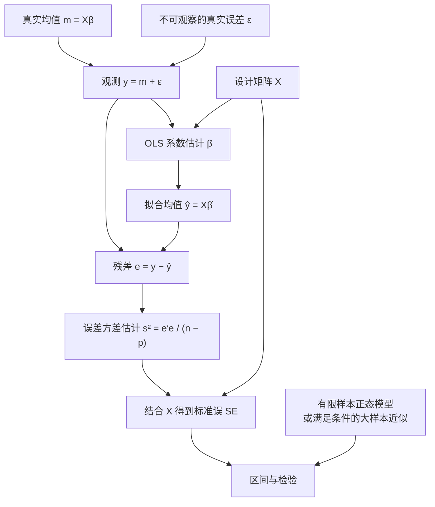

# 线性回归：期望、方差、残差与预测区间

## Purpose and review status

- Category: Statistics
- Tags: OLS, Expectation, Bias, Variance, Residuals, Degrees of Freedom, Prediction, LLN, CLT
- Date Added: 2026-10-23
- Source: [2026-10-11 Q7](../../DailyTests/2026-10-11.md#q7--confidence-vs-prediction-intervals) 及后续中文复习讨论。
- Status: 复习知识卡；整理已讨论的流程图与推导，不改变原题的独立完成记录。

**阅读顺序：先看流程图，再读第 1–6 节；第 7 节的随机设计扩展可按需展开。** 第 8 节用条件对照表回答“正态到底什么时候用”。

## 1. 重复实验：到底对什么取期望？

先固定同一组设计矩阵 $`X`$。真实参数 $`\beta`$ 和误差方差 $`\sigma^2`$ 固定但未知，每次重新生成真实误差 $`\varepsilon`$，就得到一份新的 $`y`$，进而得到不同的系数估计、拟合值、残差和方差估计。

期望与方差描述这些量在**重复抽样中的分布**。一次回归得到的系数向量只是一份实现；不能对其中几个不同系数求样本方差，就把它当作某个系数估计量的抽样方差。

模型和条件分开写：

```math
y=X\beta+\varepsilon,\qquad
X\in\mathbb R^{n\times p},\qquad
\mathrm{rank}(X)=p,\qquad n\gt p.
```

本卡的带截距模型中，$`p`$ 包含截距。以下用三层条件标记结论：

| 条件 | 内容 | 主要作用 |
| --- | --- | --- |
| A：代数条件 | 线性表示、满列秩 | 定义 OLS、投影与残差 |
| B：均值条件 | $`E(\varepsilon\mid X)=0`$ | 条件无偏 |
| C：经典协方差条件 | $`\mathrm{Cov}(\varepsilon\mid X)=\sigma^2I_n`$ | 同方差且误差互不相关，得到经典方差公式 |

条件 C 不要求误差独立。正态分布是后面做有限样本精确推断时额外加入的条件。



图中的步骤分别回答：观测从哪里来、怎样估计均值、拟合后剩多少、这些估计有多不稳定、最后依据什么分布做推断。图本身不证明条件 B 或 C；这些是模型假设。

## 2. 核心代数：为什么估计误差等于 Aε？

### 第一步：定义从观测到系数的线性映射

```math
A=(X^\top X)^{-1}X^\top\in\mathbb R^{p\times n},
\qquad \hat\beta=Ay.
```

### 第二步：利用满列秩消掉 X

```math
AX=(X^\top X)^{-1}(X^\top X)=I_p.
```

### 第三步：把模型代入，一行做一步

```math
\begin{aligned}
\hat\beta
&=Ay\\
&=A(X\beta+\varepsilon)\\
&=(AX)\beta+A\varepsilon\\
&=\beta+A\varepsilon.
\end{aligned}
```

所以：

```math
\boxed{\hat\beta-\beta=A\varepsilon.}
```

**这是纯代数恒等式，只用 A，不需要零均值、同方差或正态。** 再加入 B，才有：

```math
E(\hat\beta-\beta\mid X)=A\,E(\varepsilon\mid X)=0.
```

这里的两个“误差”不能互换：

```math
\underbrace{\varepsilon=y-X\beta}_{\text{真实误差：依赖未知参数}},
\qquad
\underbrace{e=y-X\hat\beta}_{\text{拟合残差：可由样本计算}}.
```

OLS 的正规方程给出 $`X^\top e=0`$，因此 $`Ae=0`$。如果把上式中的真实误差换成残差，就会错误地推出每次都估得完全正确。

还要区分：$`\hat\beta-\beta`$ 是一次样本的 **estimation error（估计误差）**；统计上的 **bias（偏倚）** 是它的期望。

## 3. 用投影矩阵统一期望、协方差和残差

定义 hat matrix 和 residual maker：

```math
H=XA=X(X^\top X)^{-1}X^\top,\qquad M=I_n-H.
```

它们是对称幂等矩阵：

```math
H^\top=H,\quad H^2=H,\quad
M^\top=M,\quad M^2=M,\quad HM=0.
```

因为 $`HX=X`$、$`MX=0`$，三条关键表示式为：

```math
\hat\beta-\beta=A\varepsilon,\qquad
\hat y-X\beta=H\varepsilon,\qquad
e=M\varepsilon.
```

给定 $`X`$ 时，$`A,H,M`$ 都是固定矩阵。对固定矩阵 $`B_0`$，使用：

```math
E(B_0\varepsilon\mid X)=B_0E(\varepsilon\mid X),\qquad
\mathrm{Cov}(B_0\varepsilon\mid X)
=B_0\mathrm{Cov}(\varepsilon\mid X)B_0^\top.
```

于是得到下表。**期望列用 A+B；协方差列用 A+C。**

| 随机量 | 条件期望 | 条件协方差 |
| --- | --- | --- |
| $`y`$ | $`X\beta`$ | $`\sigma^2I_n`$ |
| $`\hat\beta`$ | $`\beta`$ | $`\sigma^2(X^\top X)^{-1}`$ |
| $`\hat y`$ | $`X\beta`$ | $`\sigma^2H`$ |
| $`e`$ | $`0`$ | $`\sigma^2(I_n-H)`$ |

例如系数协方差的简化是：

```math
\begin{aligned}
\mathrm{Cov}(\hat\beta\mid X)
&=\sigma^2AA^\top\\
&=\sigma^2(X^\top X)^{-1}X^\top X(X^\top X)^{-1}\\
&=\sigma^2(X^\top X)^{-1}.
\end{aligned}
```

### 单个训练点与残差相关性

记 $`h_{ii}=H_{ii}`$，则：

```math
\mathrm{Var}(\hat y_i\mid X)=\sigma^2h_{ii},\qquad
\mathrm{Var}(e_i\mid X)=\sigma^2(1-h_{ii}).
```

对不同的 $`i,j`$，有 $`\mathrm{Cov}(e_i,e_j\mid X)=-\sigma^2h_{ij}`$。即使原始误差互不相关，拟合残差通常也相关，因为它们共享同一份系数估计。

同时，在 A+C 下：

```math
\mathrm{Cov}(\hat y,e\mid X)
=\sigma^2HM^\top=0.
```

零协方差不能单独推出独立；若额外假设条件联合正态，才可由此推出 $`\hat y`$ 与 $`e`$ 条件独立。

**拟合值无偏估计的是条件均值 $`X\beta`$。** 它不负责还原某次观测中已经发生的随机噪声。含截距时，$`\mathbf1^\top e=0`$ 是每份样本都成立的代数性质；样本残差均值为零不能验证总体的 $`E(\varepsilon\mid X)=0`$。

### Bias、Variance 与 MSE 分别围绕什么？

对固定的标量目标 $`\theta`$：

```math
\mathrm{Bias}(\hat\theta\mid X)=E(\hat\theta\mid X)-\theta,
```

```math
\mathrm{Var}(\hat\theta\mid X)
=E\!\left[(\hat\theta-E(\hat\theta\mid X))^2\mid X\right],
```

```math
\mathrm{MSE}(\hat\theta\mid X)
=E[(\hat\theta-\theta)^2\mid X]
=\mathrm{Var}(\hat\theta\mid X)+\mathrm{Bias}(\hat\theta\mid X)^2.
```

无偏描述重复抽样的中心正确，不保证单次估计接近真值。相关特征可以使方差很大而不引入偏倚，见 [S001](../../Questions/Statistics/S001_OLS_Bias_vs_Variance_with_Correlated_Regressors.md)。

## 4. 残差怎样估计误差方差？为什么除以 n−p？

先令 $`\mathrm{RSS}=e^\top e`$。由于 $`e=M\varepsilon`$ 且 $`M^\top M=M`$：

```math
e^\top e=\varepsilon^\top M\varepsilon.
```

在 A+B+C 下，利用二次型期望与迹：

```math
\begin{aligned}
E(e^\top e\mid X)
&=\mathrm{tr}\!\left(ME(\varepsilon\varepsilon^\top\mid X)\right)\\
&=\sigma^2\mathrm{tr}(M)\\
&=\sigma^2\bigl(n-\mathrm{tr}(H)\bigr)\\
&=(n-p)\sigma^2.
\end{aligned}
```

其中 $`\mathrm{tr}(H)=\mathrm{rank}(H)=p`$。残差满足 $`p`$ 个独立的线性约束 $`X^\top e=0`$，所以残差空间维数是 $`n-p`$。于是：

```math
\boxed{s^2=\frac{e^\top e}{n-p},\qquad E(s^2\mid X)=\sigma^2.}
```

此无偏结论**无需正态**。若直接除以 $`n`$，期望是 $`(n-p)\sigma^2/n`$。把残差当作普通 iid 样本再除以 $`n-1`$，在 $`p\gt1`$ 时也不能无偏估计 $`\sigma^2`$。

用 $`s^2`$ 替代未知的 $`\sigma^2`$：

```math
\widehat{\mathrm{Cov}}(\hat\beta\mid X)
=s^2(X^\top X)^{-1},\qquad
\widehat{\mathrm{SE}}_j
=s\sqrt{[(X^\top X)^{-1}]_{jj}}.
```

| 名称 | 这里的对象 | 单位与含义 |
| --- | --- | --- |
| 误差方差 variance | $`\sigma^2`$，估计为 $`s^2`$ | 响应单位的平方；数据噪声大小 |
| 误差标准差 standard deviation | $`\sigma`$，常用 $`s`$ 估计 | 响应单位；$`s`$ 本身通常不是无偏估计 |
| 系数标准误 standard error | $`\sqrt{\mathrm{Var}(\hat\beta_j\mid X)}`$，用上式估计 | 系数单位；估计量在重复抽样中的波动 |

## 5. 特征样本方差的 n−1，与回归误差的 n−p

### 两种方差估计的是不同对象

设每个观测有 $`d=p-1`$ 个非截距特征，记为列向量 $`x_i`$。特征总体协方差是 $`\Sigma_x=\mathrm{Cov}(x_i)`$，样本协方差为：

```math
S_x=\frac1{n-1}\sum_{i=1}^n(x_i-\bar x)(x_i-\bar x)^\top.
```

对 iid 且有有限二阶矩的特征，$`E(S_x)=\Sigma_x`$。这是**输入如何分散**；$`s^2`$ 估计的则是给定输入后，**输出还剩多少误差方差** $`\sigma^2`$。

令 $`X_c`$ 为逐列中心化后的非截距特征矩阵，则按定义：

```math
X_c^\top X_c=(n-1)S_x.
```

带截距、满列秩且满足 C 的回归中，斜率向量 $`\hat b`$ 的条件协方差精确为：

```math
\mathrm{Cov}(\hat b\mid X)
=\sigma^2(X_c^\top X_c)^{-1}
=\frac{\sigma^2}{n-1}S_x^{-1}.
```

这里是把同一个交叉乘积矩阵改写为样本协方差，**不是把所有公式里的 n 都改成 n−1**。此条件恒等式也不要求特征先来自某个正态总体。

一元带截距回归中：

```math
\mathrm{Var}(\hat b\mid X)
=\frac{\sigma^2}{\sum_i(x_i-\bar x)^2}
=\frac{\sigma^2}{(n-1)s_x^2}.
```

估计这个方差时，分子用 $`s^2=\mathrm{RSS}/(n-2)`$，因为此时估计了截距与一个斜率。输入沿相关方向更分散，通常提供更多信息；输出噪声更大，估计精度更低。多元回归还要看特征之间的相关性，不能只比较各列的边际方差。

### 为什么普通样本方差除以 n−1？

令标量 $`X_1,\ldots,X_n`$ iid，$`E(X_i)=\mu`$、$`\mathrm{Var}(X_i)=\sigma_x^2`$。先用恒等式：

```math
\sum_{i=1}^n(X_i-\bar X)^2
=\sum_{i=1}^n(X_i-\mu)^2-n(\bar X-\mu)^2.
```

再分别取期望：

```math
\begin{aligned}
E\!\left[\sum_i(X_i-\bar X)^2\right]
&=n\sigma_x^2-n\,\mathrm{Var}(\bar X)\\
&=n\sigma_x^2-n\frac{\sigma_x^2}{n}\\
&=(n-1)\sigma_x^2.
\end{aligned}
```

所以除以 $`n-1`$ 无偏。若总体均值 $`\mu`$ 已知，围绕真实均值计算 $`\sum_i(X_i-\mu)^2/n`$ 就已经无偏。这两条结论都无需正态。

<details>
<summary>矩阵中心化：和回归自由度的同一条线索</summary>

令 $`v=(X_1,\ldots,X_n)^\top`$，中心化矩阵为：

```math
C=I_n-\frac{\mathbf1\mathbf1^\top}{n},\qquad
C\mathbf1=0,\qquad \mathrm{tr}(C)=n-1.
```

于是：

```math
\sum_i(X_i-\bar X)^2=v^\top Cv,
\qquad
E(v^\top Cv)=\sigma_x^2\mathrm{tr}(C)=(n-1)\sigma_x^2.
```

样本中心化移除了常数方向；一般 OLS 残差化移除了 $`X`$ 的整个 $`p`$ 维列空间。因此分母分别是 $`n-1`$ 和 $`n-p`$。

</details>

## 6. 预测均值，还是预测一个新观测？

固定一个含截距的新输入向量 $`x_0\in\mathbb R^p`$，定义：

```math
m_0=x_0^\top\beta,\qquad
\hat m_0=x_0^\top\hat\beta,\qquad
h_0=x_0^\top(X^\top X)^{-1}x_0.
```

这里 $`h_0`$ 是新输入相对于训练设计的方差因子，不一定小于 1。在 A+B+C 下：

```math
E(\hat m_0\mid X)=m_0,\qquad
\mathrm{Var}(\hat m_0\mid X)=\sigma^2h_0.
```

这只描述**估计真实均值的不确定性**。如果要预测一个独立的新观测，则另有：

```math
y_0=m_0+\varepsilon_0,\qquad
E(\varepsilon_0\mid X)=0,\qquad
\mathrm{Var}(\varepsilon_0\mid X)=\sigma^2,
```

并假设给定 $`X`$，新误差与训练误差独立。预测误差分解为：

```math
y_0-\hat m_0=\varepsilon_0-x_0^\top(\hat\beta-\beta).
```

两项条件协方差为零，所以：

```math
\boxed{\mathrm{Var}(y_0-\hat m_0\mid X)
=\sigma^2+\sigma^2h_0=\sigma^2(1+h_0).}
```

| 问题 | 目标 | 相应方差 |
| --- | --- | --- |
| 在此输入下，平均响应是多少？ | $`m_0`$ | $`\mathrm{Var}(\hat m_0\mid X)=\sigma^2h_0`$ |
| 一个新响应本身怎样波动？ | $`y_0`$ | $`\mathrm{Var}(y_0\mid X)=\sigma^2`$ |
| 用估计均值预测新响应，会错多少？ | $`y_0-\hat m_0`$ | $`\sigma^2(1+h_0)`$ |

不能把新观测自身的方差、估计均值的方差、预测误差的方差混用。

### 正态条件下的精确区间

若额外有 $`\varepsilon\mid X\sim N(0,\sigma^2I_n)`$，均值的置信区间为：

```math
\text{Mean CI:}\qquad
\hat m_0\pm t_{n-p,\,1-\alpha/2}\,s\sqrt{h_0}.
```

若独立新误差还满足 $`\varepsilon_0\mid X\sim N(0,\sigma^2)`$，新观测的预测区间为：

```math
\text{New-observation PI:}\qquad
\hat m_0\pm t_{n-p,\,1-\alpha/2}\,s\sqrt{1+h_0}.
```

同一置信水平下，PI 更宽，因为有未来观测自己的噪声。一元带截距回归的方差因子是：

```math
h_0=\frac1n+\frac{(x_0-\bar x)^2}{\sum_i(x_i-\bar x)^2}.
```

此处一元式的 $`x_0`$ 指标量特征值。离设计中心越远，估计均值越不确定；区间不保护模型错误或外推失效。原题和一元推导见 [S017](../../Questions/Statistics/S017_Confidence_and_Prediction_Intervals.md)。[Penn State STAT 501](https://online.stat.psu.edu/stat501/Lesson03) 也区分了两个预测目标及其对正态条件的不同依赖。

## 7. 延伸：如果 X 也随机，怎样取无条件方差？

<details>
<summary>展开：全协方差公式、样本内波动与固定新输入</summary>

### 先条件化，再对设计取平均

给定 $`X`$ 时，$`H`$ 是固定的。$`X`$ 或 $`H`$ 的未知，不等于它在这一条件分布里随机；只有把 $`X`$ 也纳入重复抽样，才讨论随机设计。

对具有有限二阶矩的向量 $`Z`$，全协方差公式为：

```math
\mathrm{Cov}(Z)
=E[\mathrm{Cov}(Z\mid X)]
+\mathrm{Cov}(E[Z\mid X]).
```

若条件 B、C 对随机设计成立、$`X`$ 几乎处处满列秩，且所需期望存在：

```math
\mathrm{Cov}(\hat\beta)
=\sigma^2E[(X^\top X)^{-1}],
```

```math
\mathrm{Cov}(e)=\sigma^2(I_n-EH),
```

```math
\mathrm{Cov}(\hat y)
=\mathrm{Cov}(X\beta)+\sigma^2EH.
```

第一式中的“先求逆再取期望”一般不等于“先取期望再求逆”。某些随机设计下逆矩阵的期望甚至不存在，因此满秩本身不足以保证无条件系数方差有限。

### 同一训练点的无条件方差

写 $`\beta=(\alpha,b^\top)^\top`$，非截距特征行 $`x_i`$ iid，$`\Sigma_x=\mathrm{Cov}(x_i)`$ 有限。不同训练点的真实均值彼此独立，故：

```math
\mathrm{Cov}(X\beta)=(b^\top\Sigma_xb)I_n.
```

iid 行使设计对行置换可交换，因此各 $`E(h_{ii})`$ 相同；再由 $`\sum_i h_{ii}=p`$，有：

```math
E(h_{ii})=\frac pn.
```

于是，对**样本内、无条件**的同一个训练点：

```math
\mathrm{Var}(e_i)=\sigma^2\left(1-\frac pn\right),\qquad
\mathrm{Var}(\hat y_i)=b^\top\Sigma_xb+\sigma^2\frac pn.
```

第二式包含“随机输入导致真实均值变化”这一项。它不是固定新输入下的均值估计方差。仅各行边际同分布但不具备可交换性时，不能直接断言 $`E(h_{ii})=p/n`$。

### LLN 给出样本矩的极限

令设计行的转置为 $`z_i=(1,x_i^\top)^\top`$，$`\mu=E(x_i)`$，则：

```math
Q=E(z_iz_i^\top)
=\begin{pmatrix}
1&\mu^\top\\
\mu&\Sigma_x+\mu\mu^\top
\end{pmatrix}.
```

在 iid、有限二阶矩、$`p`$ 固定且 $`Q`$ 正定时，由 LLN 和连续映射：

```math
\frac{X^\top X}{n}\xrightarrow{p}Q,\qquad
n(X^\top X)^{-1}\xrightarrow{p}Q^{-1}.
```

因此经典条件协方差的大样本近似为：

```math
\mathrm{Cov}(\hat\beta\mid X)\approx\frac{\sigma^2}{n}Q^{-1},\qquad
\mathrm{Cov}(\hat b\mid X)\approx\frac{\sigma^2}{n}\Sigma_x^{-1}.
```

这里 $`Q^{-1}`$ 的斜率块为 $`\Sigma_x^{-1}`$。若要进一步断言实际**无条件**协方差也按此近似，还需控制逆样本矩阵的尾部，使相应矩收敛成立，例如适当的一致可积条件；分布收敛或概率收敛本身不保证矩收敛。

对固定的新特征向量 $`u_0`$，令含截距输入 $`x_0=(1,u_0^\top)^\top`$，有：

```math
\mathrm{Var}(\hat m_0\mid X)
\approx\frac{\sigma^2}{n}
\left[1+(u_0-\mu)^\top\Sigma_x^{-1}(u_0-\mu)\right].
```

在保证上述矩收敛的附加条件下，$`\mathrm{Var}(\hat m_0)`$ 也有此近似。新输入固定时，目标 $`m_0=x_0^\top\beta`$ 固定，不应额外加上不同输入之间的真实均值变化 $`b^\top\Sigma_xb`$。

</details>

## 8. 正态、LLN 和 CLT 各负责什么？

### LLN 与 CLT 的两步分工

LLN 使平均量、样本矩向总体矩收敛，并在合适条件下帮助证明一致性。它不会让原始 $`X`$ 或 $`\varepsilon`$ 变成正态。

在 iid 随机设计下，假设观测对 $`(z_i,\varepsilon_i)`$ iid、$`p`$ 固定、$`Q`$ 正定、$`E(\varepsilon_i\mid z_i)=0`$、$`E(\varepsilon_i^2\mid z_i)=\sigma^2`$，且相关二阶矩有限（特别是 $`E\|z_i\varepsilon_i\|^2\lt\infty`$）。从估计误差恒等式出发：

```math
\sqrt n(\hat\beta-\beta)
=\left(\frac{X^\top X}{n}\right)^{-1}
\left(\frac{X^\top\varepsilon}{\sqrt n}\right).
```

先看左边的矩阵因子，LLN 给出：

```math
\left(\frac{X^\top X}{n}\right)^{-1}\xrightarrow{p}Q^{-1}.
```

再看右边的求和因子，多元 CLT 给出：

```math
\frac{X^\top\varepsilon}{\sqrt n}
=\frac1{\sqrt n}\sum_i z_i\varepsilon_i
\xrightarrow{d}N(0,\sigma^2Q).
```

两者结合（Slutsky）：

```math
\boxed{\sqrt n(\hat\beta-\beta)
\xrightarrow{d}N(0,\sigma^2Q^{-1}).}
```

CLT 给的是**标准化估计误差**的渐近正态；原始特征、误差和观测仍可非正态。学生化后做大样本推断，还要标准误一致。上述 LLN / CLT 分工也见 [StatLect 的 OLS 渐近性质讲义](https://www.statlect.com/fundamentals-of-statistics/OLS-estimator-properties)。固定设计也可建立相应渐近理论，但需另列设计序列条件，不能直接照搬 iid 随机设计论证。

### 额外加正态：获得有限样本精确分布

若在 A 下进一步假设：

```math
\varepsilon\mid X\sim N(0,\sigma^2I_n),
```

则 B、C 自动满足，而且有：

```math
\hat\beta\mid X\sim
N\!\left(\beta,\sigma^2(X^\top X)^{-1}\right),
\qquad
\frac{(n-p)s^2}{\sigma^2}\Bigm|X\sim\chi^2_{n-p}.
```

$`A\varepsilon`$ 与 $`M\varepsilon`$ 联合正态且协方差为零，所以 $`\hat\beta`$ 与 $`s^2`$ **条件独立**。于是：

```math
\frac{\hat\beta_j-\beta_j}
{s\sqrt{[(X^\top X)^{-1}]_{jj}}}
\Biggm|X\sim t_{n-p}.
```

经典线性约束的 F 检验也在相应原假设下精确成立。这里要求误差给定设计后正态，**不需要 X 正态**；随机设计下的条件正态也不自动意味着无条件分布是同一个正态。

| 结论 | 所需条件概要 | 是否需正态？ |
| --- | --- | --- |
| OLS 公式、投影、估计误差分解 | A | 不需要 |
| 条件无偏 | A+B | 不需要 |
| 经典条件协方差公式 | A+C | 不需要 |
| $`s^2`$ 无偏估计 $`\sigma^2`$ | A+B+C，$`n\gt p`$ | 不需要 |
| 样本矩收敛、OLS 一致性 | 相应 LLN、识别与外生性条件 | 不需要 |
| 标准化系数误差渐近正态 | LLN、CLT、非退化设计与有限矩等条件 | 不要求原始误差正态 |
| 有限样本精确正态、卡方、t / F | A + 条件正态球形误差 | 需要此额外分布假设 |
| 精确均值 CI | 上述正态模型 | 经典 t 区间需要 |
| 单个新观测的精确正态 PI | 上述模型 + 独立同方差正态新误差 | 也需要新误差的分布条件 |

正态假设不能消除遗漏变量或内生性。异方差会把系数协方差改为 $`A\Omega A^\top`$，其中 $`\Omega=\mathrm{Cov}(\varepsilon\mid X)`$；只要 B 仍成立，OLS 仍条件无偏，但经典标准误一般不再正确，需要合适的稳健协方差。参见 [S010](../../Questions/Statistics/S010_OLS_Significance_Randomness_and_Robust_Standard_Errors.md)。

**训练样本很大，也不会让单个未来误差自动正态。** 均值 CI 可以借助估计量的 CLT 作近似；单个新观测的正态 PI 不能只靠训练样本量大来保证覆盖率，还需要未来误差分布的依据。

## 9. 自测：能否不看推导回答？

1. 固定 $`X`$ 重复实验时，哪些量固定，哪些量变化？
2. 从 $`AX=I_p`$ 分步推到 $`\hat\beta-\beta=A\varepsilon`$；哪一步开始用零均值？
3. 为什么不能用残差 $`e`$ 替代真实误差 $`\varepsilon`$？
4. 为什么 $`s^2`$ 除以 $`n-p`$，特征样本方差却除以 $`n-1`$？
5. $`\sigma^2h_0`$、$`\sigma^2`$、$`\sigma^2(1+h_0)`$ 分别是谁的方差？
6. 哪些结论只需要矩条件，哪些精确推断才需要正态？
7. 给定 $`X`$ 的方差、随机设计的无条件方差、固定新输入的预测方差有什么区别？

## Related questions and knowledge

- [S017 — Confidence and Prediction Intervals](../../Questions/Statistics/S017_Confidence_and_Prediction_Intervals.md) — 原题与一元区间推导。
- [S001 — OLS Bias vs Variance with Correlated Regressors](../../Questions/Statistics/S001_OLS_Bias_vs_Variance_with_Correlated_Regressors.md) — 共线性、估计方差与遗漏变量。
- [S010 — OLS Significance, Randomness, and Robust Standard Errors](../../Questions/Statistics/S010_OLS_Significance_Randomness_and_Robust_Standard_Errors.md) — 推断对象、异方差与稳健标准误。
- [SVD / QR / Conditioning / Least Squares / PCA](../LinearAlgebra/SVD_QR_Conditioning_Least_Squares_and_PCA.md) — 设计矩阵、投影与数值稳定性。
- [2026-10-11 Q7 的复习记录](../../DailyTests/2026-10-11.md#q7--confidence-vs-prediction-intervals)。
